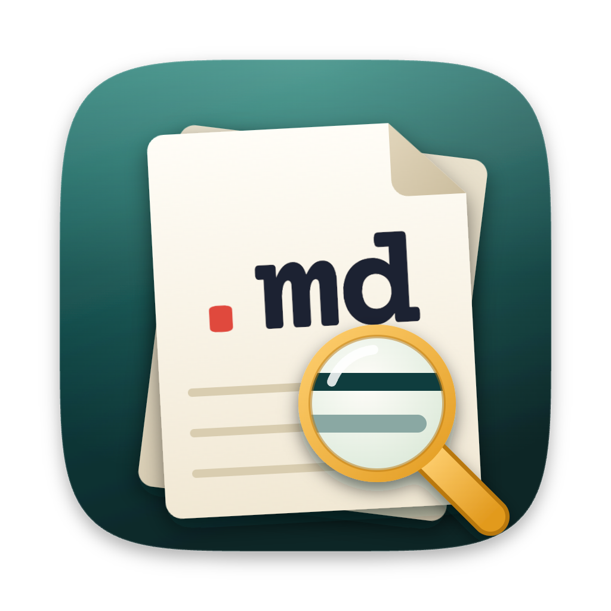
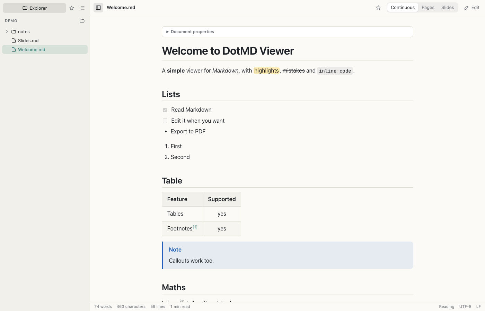
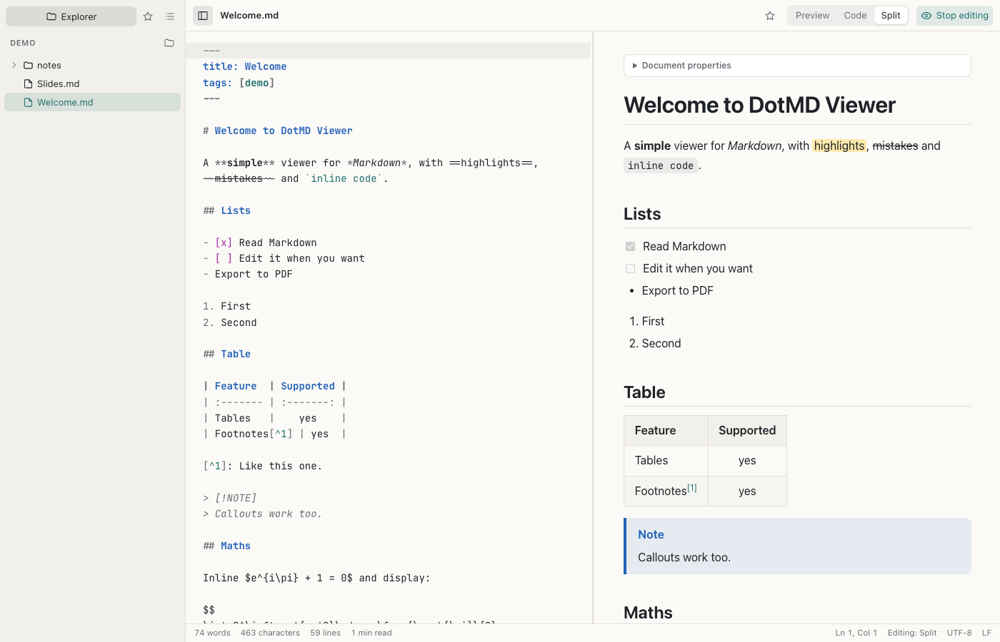
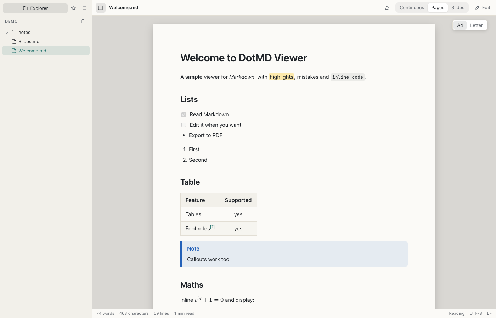
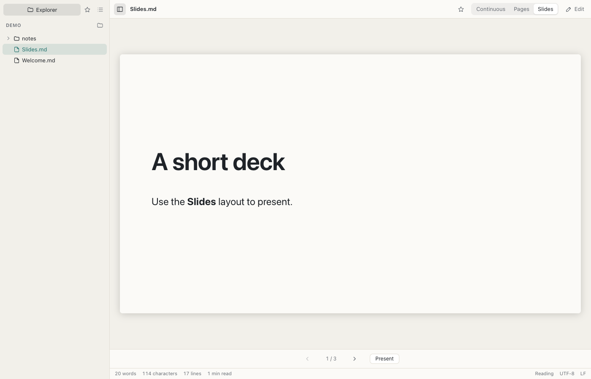
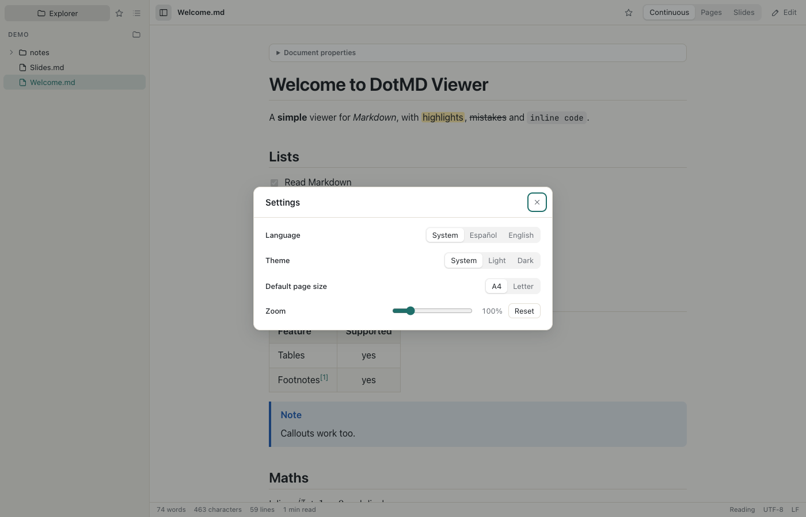

<p align="center">
  
</p>

# DotMD Viewer

[](https://github.com/jgestal/dotmd-viewer/actions/workflows/ci.yml)

Un visor de Markdown sencillo y multiplataforma, con edición opcional, para macOS, Windows y Linux.
El hermano pequeño de [DotMD](https://github.com/jgestal/dotmd).

**[Read in English](../README.md)**

<picture>
  <source media="(prefers-color-scheme: dark)" srcset="screenshots/readme-reading-dark.png">
  
</picture>

DotMD Viewer abre cada documento en una vista previa de solo lectura y solo pasa a edición cuando lo pides.
Renderiza Markdown con estilo GitHub, fórmulas con KaTeX y diagramas con Mermaid, y muestra cada documento como una
página continua, como hojas A4 o Carta paginadas, o como diapositivas. Está hecho con Tauri 2, Rust y SvelteKit.

## Funciones

**Diseños de lectura**

- **Continua**: el documento entero como una única página con desplazamiento.
- **Páginas**: hojas A4 o Carta sobre una mesa gris, con números de página, encabezados que se mantienen con el
  bloque siguiente y saltos de página manuales (`\pagebreak`).
- **Diapositivas**: el documento se divide en diapositivas en cada `---` de primer nivel, con navegación por flechas,
  espacio, Inicio y Fin, y un modo Presentar a pantalla completa.

**Edición**

- Los documentos se abren en solo lectura. **Editar** (`Cmd+E` / `Ctrl+E`) activa la edición, y los modos de vista son:
  - **Vista previa**: edición WYSIWYG; el Markdown que no tocas se conserva byte a byte.
  - **Código**: CodeMirror 6 con resaltado de Markdown, deshacer y rehacer, buscar y reemplazar.
  - **Dividida**: código y vista previa lado a lado, con un divisor arrastrable y desplazamiento sincronizado.
- Los cambios sin guardar se marcan, y al cerrar la ventana o salir la app pregunta si guardar, descartar o cancelar.

**Markdown**

- Markdown de GitHub: tablas, listas de tareas, tachado, notas al pie y alertas (`> [!NOTE]`), además de `==resaltados==`.
- Fórmulas con KaTeX, diagramas con Mermaid y resaltado de sintaxis en los bloques de código.
- Front matter en YAML, que se muestra como propiedades del documento.
- Imágenes locales, resueltas respecto a la carpeta del documento.

**Archivos y navegación**

- Una barra lateral plegable y redimensionable con las pestañas **Explorador** (árbol de carpetas), **Favoritos** e
  **Índice** (encabezados).
- Abre archivos desde el Finder o el Explorador, con doble clic, arrastrándolos o desde la línea de comandos. Un segundo
  lanzamiento entrega sus archivos a la ventana que ya está abierta.
- Arrastra archivos y carpetas en el Explorador para moverlos, o sácalos de la app hacia otras aplicaciones.
- Menú contextual para abrir, renombrar (`F2`), mover a la papelera y mostrar en el Finder, el Explorador o tu gestor de
  archivos.
- Archivos recientes, en el menú del Dock, en **Archivo › Abrir reciente** y en la lista de accesos de Windows.
- Recarga automática cuando el archivo abierto cambia en disco.
- Se detectan y conservan al guardar la codificación de texto (UTF-8, UTF-16, windows-1252) y los finales de línea.

**Exportar e imprimir**

- Imprimir (`Cmd+P` / `Ctrl+P`) y **Exportar a PDF** (`Cmd+Shift+E` / `Ctrl+Shift+E`), generados por el motor web del
  propio sistema. Solo se imprime el documento, con la paleta clara, con fórmulas y diagramas renderizados.

**Integración con el escritorio**

- Menús nativos según cada sistema: la barra de menús de macOS, o una barra de menús en la ventana con mnemotécnicas
  Alt en Windows y Linux.
- **Ajustes** (`Cmd+,` / `Ctrl+,`) para idioma, tema, tamaño de página predeterminado y zoom.
- Interfaz en inglés y español, que sigue el idioma del sistema salvo que elijas uno.
- Temas claro y oscuro, que siguen el sistema salvo que elijas uno.

## Capturas

<p align="center">
  
</p>

<p align="center">
  
</p>

<p align="center">
  
</p>

<p align="center">
  
</p>

## Atajos de teclado

`Mod` es `⌘` (Cmd) en macOS y `Ctrl` en Windows y Linux. Cada atajo también aparece en la app, en
**Ayuda › Atajos de teclado**.

| Comando                            | macOS | Windows / Linux |
| ---------------------------------- | ----- | --------------- |
| Archivo › Nuevo                    | `⌘N`  | `Ctrl+N`        |
| Archivo › Abrir…                   | `⌘O`  | `Ctrl+O`        |
| Archivo › Abrir carpeta…           | `⌘⇧O` | `Ctrl+Shift+O`  |
| Archivo › Guardar                  | `⌘S`  | `Ctrl+S`        |
| Archivo › Guardar como…            | `⌘⇧S` | `Ctrl+Shift+S`  |
| Archivo › Exportar a PDF…          | `⌘⇧E` | `Ctrl+Shift+E`  |
| Archivo › Imprimir…                | `⌘P`  | `Ctrl+P`        |
| Archivo › Cerrar                   | `⌘W`  | `Ctrl+W`        |
| Edición › Buscar…                  | `⌘F`  | `Ctrl+F`        |
| Edición › Buscar y reemplazar…     | `⌘⌥F` | `Ctrl+Alt+F`    |
| Ver › Editar                       | `⌘E`  | `Ctrl+E`        |
| Ver › Vista previa                 | `⌘1`  | `Ctrl+1`        |
| Ver › Código                       | `⌘2`  | `Ctrl+2`        |
| Ver › Dividida                     | `⌘3`  | `Ctrl+3`        |
| Ver › Continua                     | `⌘⌥1` | `Ctrl+Alt+1`    |
| Ver › Páginas                      | `⌘⌥2` | `Ctrl+Alt+2`    |
| Ver › Diapositivas                 | `⌘⌥3` | `Ctrl+Alt+3`    |
| Ver › Mostrar barra lateral        | `⌘\`  | `Ctrl+\`        |
| Ver › Explorador                   | `⌘⇧1` | `Ctrl+Shift+1`  |
| Ver › Favoritos                    | `⌘⇧2` | `Ctrl+Shift+2`  |
| Ver › Índice                       | `⌘⇧3` | `Ctrl+Shift+3`  |
| Ver › Aumentar zoom                | `⌘=`  | `Ctrl+=`        |
| Ver › Reducir zoom                 | `⌘-`  | `Ctrl+-`        |
| Ver › Restablecer zoom             | `⌘0`  | `Ctrl+0`        |
| Ver › Pantalla completa            | `⌃⌘F` | `F11`           |
| Aplicación › Ajustes…              | `⌘,`  | `Ctrl+,`        |
| Aplicación › Salir de DotMD Viewer | `⌘Q`  | —               |

## Instalación

Descarga el instalador de tu sistema desde la [página de versiones](https://github.com/jgestal/dotmd-viewer/releases).
Las compilaciones aún no están firmadas con certificado de código, así que tu sistema pide confirmación la primera vez
que las abres. Consulta [Abrir compilaciones sin firmar](#abrir-compilaciones-sin-firmar) más abajo.

### macOS

Abre el `.dmg` y arrastra DotMD Viewer a Aplicaciones.
Para convertirla en la aplicación predeterminada de Markdown: selecciona un archivo `.md` en el Finder, pulsa `Cmd+I`,
elige DotMD Viewer en **Abrir con** y haz clic en **Cambiar todos…**. La app se registra como manejador alternativo, así
que instalarla nunca cambia tu predeterminada actual.

### Windows

Ejecuta el `.exe` (instalación por usuario, sin necesidad de derechos de administrador) o el `.msi`. El instalador
registra las extensiones `.md`, `.markdown`, `.mdown` y `.mkd` y crea un acceso directo en el menú Inicio; si falta,
instala WebView2.
Para convertirla en la predeterminada: haz clic derecho en un archivo `.md`, **Abrir con > Elegir otra aplicación**,
selecciona DotMD Viewer y marca **Usar siempre esta aplicación** (o **Configuración > Aplicaciones > Aplicaciones
predeterminadas**).

### Linux

- Debian/Ubuntu: `sudo apt install ./dotmd-viewer_*.deb`
- Fedora/openSUSE: `sudo dnf install ./dotmd-viewer-*.rpm`
- Cualquier distribución: `chmod +x DotMD*.AppImage && ./DotMD*.AppImage`

Los paquetes `.deb` y `.rpm` añaden una entrada al menú y los tipos MIME de Markdown, así que DotMD Viewer aparece en
**Abrir con** en tu gestor de archivos. Para convertirla en la predeterminada para Markdown:

```sh
xdg-mime default dotmd-viewer.desktop text/markdown text/x-markdown
```

Si la ventana se queda en blanco en algunas configuraciones de Wayland/NVIDIA, inicia la app con
`WEBKIT_DISABLE_DMABUF_RENDERER=1`.

## Abrir compilaciones sin firmar

Hasta que las compilaciones estén firmadas, cada sistema muestra una advertencia la primera vez que ejecutas DotMD
Viewer. La app es segura de abrir; la advertencia solo indica que el editor no está verificado.

| Sistema | Lo que ves                                                                                           | Qué hacer                                                                                                                                                                                                                                                           |
| ------- | ---------------------------------------------------------------------------------------------------- | ------------------------------------------------------------------------------------------------------------------------------------------------------------------------------------------------------------------------------------------------------------------- |
| macOS   | Un mensaje de que la app no se puede abrir porque no se puede verificar su desarrollador.            | Intenta abrir la app una vez. Después ve a **Ajustes del Sistema > Privacidad y seguridad**, busca el mensaje sobre DotMD Viewer y haz clic en **Abrir igualmente**. En versiones antiguas de macOS también puedes hacer clic derecho en la app y elegir **Abrir**. |
| Windows | **Windows protegió tu PC** (SmartScreen).                                                            | Haz clic en **Más información** y después en **Ejecutar de todas formas**.                                                                                                                                                                                          |
| Linux   | Normalmente nada con los paquetes `.deb` y `.rpm`. Un AppImage no se inicia hasta que es ejecutable. | Ejecuta `chmod +x` sobre el AppImage y después inícialo.                                                                                                                                                                                                            |

## Compilar desde el código

Requisitos previos:

- [Node.js](https://nodejs.org/) 22 o posterior
- [Rust](https://rustup.rs/) estable
- Los [requisitos previos de Tauri](https://v2.tauri.app/start/prerequisites/) de tu sistema operativo

```sh
npm install
npm run tauri dev     # ejecuta la app con recarga en caliente
npm run tauri build   # compila los instaladores de tu plataforma
```

`npm run build` solo compila el frontend web en `build/`. En un navegador normal, `npm run dev` abre un espacio de
trabajo de demostración en memoria, que es el que se usó para las capturas de arriba.

## Pruebas

```sh
npm test                    # Vitest: pruebas unitarias, de casos de uso y de arquitectura
npm run test:coverage       # Vitest con cobertura; mínimo del 90 % en domain y application
npm run test:rust           # cargo test para el backend en Rust
npm run test:mutation       # StrykerJS sobre domain y application, informe en reports/mutation/
npm run test:mutation:rust  # cargo-mutants sobre el backend en Rust, informe en reports/
```

Las demás comprobaciones son `npm run check` (tipos), `npm run lint`, `npm run format:check`, `npm run lint:rust` y
`cargo fmt --check` en `src-tauri`. El CI las ejecuta en cada pull request, junto con una compilación en macOS, Windows
y Linux.

La prueba de mutaciones debe alcanzar al menos un 85 %. Es un flujo manual (**Mutation testing** en GitHub Actions), y
el destino de Rust necesita `cargo install cargo-mutants` una vez.

`npm run test:e2e` ejecuta pruebas de humo con WebDriver (tauri-driver) sobre una compilación de depuración; la CI las ejecuta en Linux, más una prueba de arranque en macOS. El trabajo de Windows todavía no bloquea: msedgedriver no consigue conectarse a WebView2 en el runner de GitHub.

## Documentación

- [CONTRIBUTING.md](../CONTRIBUTING.md): ramas, commits, pull requests y la definición de hecho
- [ARCHITECTURE.md](../ARCHITECTURE.md): capas, reglas de dependencia y estrategia de pruebas
- [CHANGELOG.md](../CHANGELOG.md): historial de versiones
- [platforms.md](platforms.md): qué ofrece cada sistema operativo y cómo lo usa la app
- [releasing.md](releasing.md): cómo se publica una versión y cómo añadir los secretos de firma
- [Versiones](https://github.com/jgestal/dotmd-viewer/releases): instaladores de cada versión

## Créditos

Hecho por **Juan Gestal** — juan@gestal.es — https://gestal.es

Construido con Tauri, SvelteKit, Milkdown, CodeMirror, markdown-it, KaTeX, Mermaid y highlight.js.

## Licencia

[MIT](../LICENSE)
