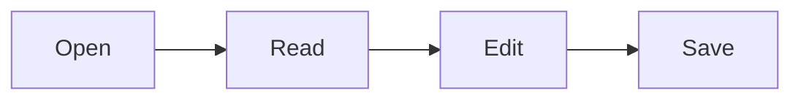

# Welcome to SimpleDotMD

SimpleDotMD opens Markdown documents to **read** them, and lets you **edit** them when you want to.
You can open this guide again at any time from **Help ▸ User Guide**. It opens in **Split** view: the Markdown on one side and the result on the other.

## Open documents

- **File ▸ Open…** (`Cmd/Ctrl+O`) opens a file, and **File ▸ Open Folder…** (`Cmd/Ctrl+Shift+O`) opens a folder in the Explorer.
- Drop Markdown files or folders anywhere in the window.
- Use **Open With ▸ SimpleDotMD** from your file manager, or drop files on the app icon.
- **File ▸ Open Recent** lists the last documents you opened.

## The sidebar

| Tab            | What it shows                                                                                                 |
| -------------- | ------------------------------------------------------------------------------------------------------------- |
| **Explorer**   | The Markdown files of the open folder. Right-click to rename, move to the trash or show in your file manager. |
| **Favourites** | Files and folders you starred with the ☆ button in the header.                                                |
| **Outline**    | The headings of the document. Click one to jump to it.                                                        |

Show or hide the sidebar with `Cmd/Ctrl+\`.

## View and edit

The document opens in **Preview**. Press **Edit** (`Cmd/Ctrl+E`) to write:

- **Preview** (`Cmd/Ctrl+1`): the rendered document, which you can also edit directly.
- **Code** (`Cmd/Ctrl+2`): the Markdown source.
- **Split** (`Cmd/Ctrl+3`): source and preview side by side, scrolling together.

Three layouts: **Continuous**, **Pages** (A4 or Letter, as printed) and **Slides** (each `---` starts a new slide).

## Maths and diagrams

Maths with KaTeX, inline like $e^{i\pi} + 1 = 0$ or as a block:

$$
\int_0^1 x^2\,dx = \frac{1}{3}
$$

Diagrams with Mermaid:

## Save, export and print

- **File ▸ Save** (`Cmd/Ctrl+S`) and **Save As…** (`Cmd/Ctrl+Shift+S`). The app asks before closing a document with unsaved changes.
- **File ▸ Export to PDF…** (`Cmd/Ctrl+Shift+E`) and **Print…** (`Cmd/Ctrl+P`).

## Settings

**Settings** (`Cmd/Ctrl+,`) changes the language, the theme (light, dark or the system's) and the page size.
**Help ▸ Keyboard Shortcuts** lists every shortcut.

---

SimpleDotMD is free software under the MIT licence, made by Juan Gestal — [gestal.es](https://gestal.es).
