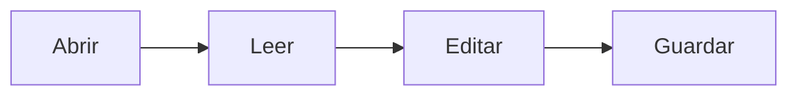

# Te damos la bienvenida a SimpleDotMD

SimpleDotMD abre documentos Markdown para **leerlos** y te deja **editarlos** cuando quieras.
Puedes volver a abrir esta guía cuando quieras desde **Ayuda ▸ Guía de uso**. Se abre en vista **Dividida**: el Markdown a un lado y el resultado al otro.

## Abrir documentos

- **Archivo ▸ Abrir…** (`Cmd/Ctrl+O`) abre un archivo y **Archivo ▸ Abrir carpeta…** (`Cmd/Ctrl+Mayús+O`) abre una carpeta en el Explorador.
- Suelta archivos Markdown o carpetas en cualquier parte de la ventana.
- Usa **Abrir con ▸ SimpleDotMD** desde el gestor de archivos, o suelta archivos sobre el icono de la app.
- **Archivo ▸ Abrir reciente** muestra los últimos documentos que has abierto.

## La barra lateral

| Pestaña        | Qué muestra                                                                                                                                 |
| -------------- | ------------------------------------------------------------------------------------------------------------------------------------------- |
| **Explorador** | Los archivos Markdown de la carpeta abierta. Con el botón derecho puedes renombrar, mover a la papelera o mostrar en el gestor de archivos. |
| **Favoritos**  | Los archivos y carpetas que marcas con el botón ☆ de la cabecera.                                                                           |
| **Índice**     | Los títulos del documento. Pulsa uno para ir a él.                                                                                          |

Muestra u oculta la barra lateral con `Cmd/Ctrl+\`.

## Ver y editar

El documento se abre en **Vista previa**. Pulsa **Editar** (`Cmd/Ctrl+E`) para escribir:

- **Vista previa** (`Cmd/Ctrl+1`): el documento ya formateado, que también puedes editar directamente.
- **Código** (`Cmd/Ctrl+2`): el texto Markdown.
- **Dividida** (`Cmd/Ctrl+3`): código y vista previa lado a lado, con el desplazamiento sincronizado.

Tres disposiciones: **Continua**, **Páginas** (A4 o Carta, como al imprimir) y **Diapositivas** (cada `---` empieza una diapositiva nueva).

## Matemáticas y diagramas

Matemáticas con KaTeX, en línea como $e^{i\pi} + 1 = 0$ o en bloque:

$$
\int_0^1 x^2\,dx = \frac{1}{3}
$$

Diagramas con Mermaid:

## Guardar, exportar e imprimir

- **Archivo ▸ Guardar** (`Cmd/Ctrl+S`) y **Guardar como…** (`Cmd/Ctrl+Mayús+S`). La app pregunta antes de cerrar un documento con cambios sin guardar.
- **Archivo ▸ Exportar a PDF…** (`Cmd/Ctrl+Mayús+E`) e **Imprimir…** (`Cmd/Ctrl+P`).

## Ajustes

**Ajustes** (`Cmd/Ctrl+,`) cambia el idioma, el tema (claro, oscuro o el del sistema) y el tamaño de página.
**Ayuda ▸ Atajos de teclado** muestra todos los atajos.

---

SimpleDotMD es software libre con licencia MIT, hecho por Juan Gestal — [gestal.es](https://gestal.es).
